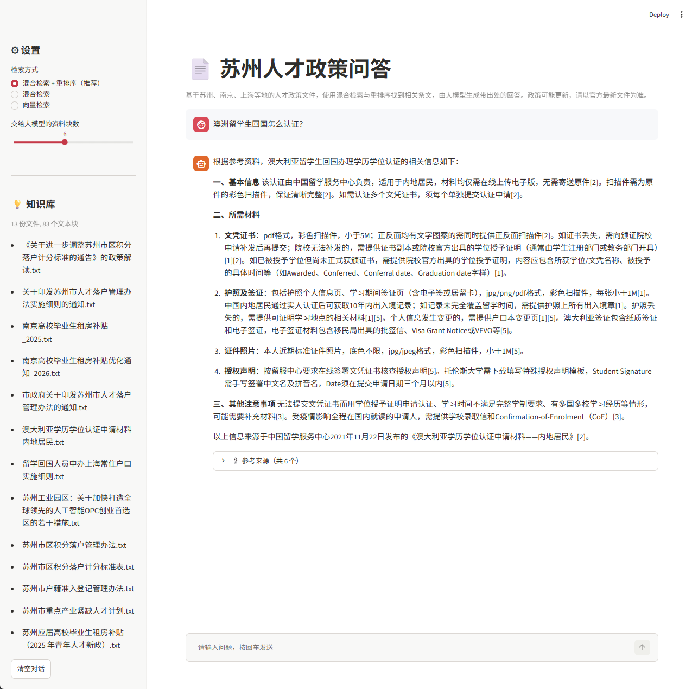
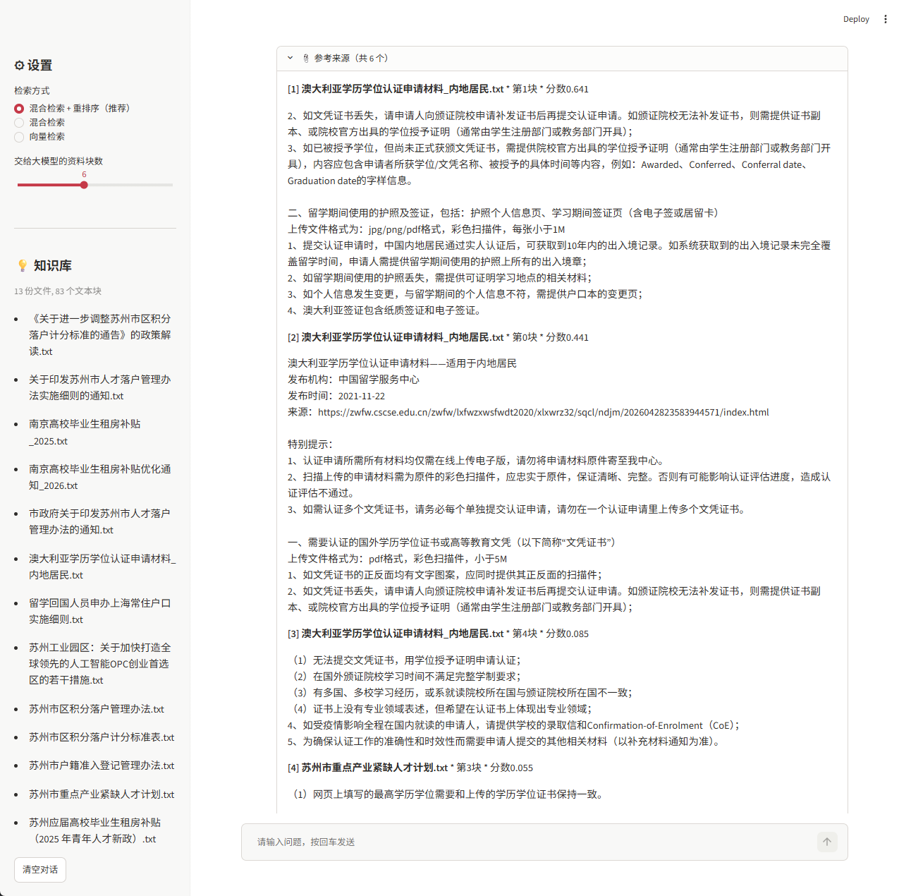
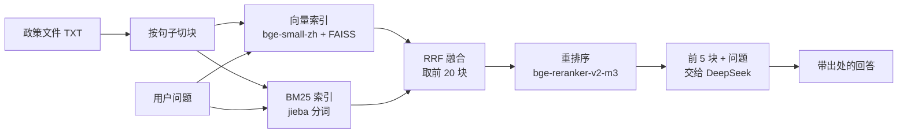

# 苏州人才政策问答（RAG）

基于 RAG（检索增强生成）的中文政策问答系统。用户用自然语言提问，系统从政策文件中检索相关条文，交给大模型生成回答，**每条关键信息都标注出处**，并可以展开查看原文。



## 项目背景

作为准备回国求职的留学生，我需要了解学历认证、人才落户、租房补贴、人才计划等政策。这些信息分散在不同城市、不同部门的文件里，有的还会被新文件更新或替代，查找起来很麻烦。

这个项目把相关政策文件整理成知识库，让用户直接提问，并且能**核对每个答案的原文出处**，避免大模型凭空编造。

## 功能

- **带出处的回答**：回答中的 `[1]`、`[2]` 对应检索到的原文段落，可以展开核对
- **混合检索 + 重排序**：向量检索与 BM25 关键词检索融合，再用 Cross-Encoder 精排
- **拒答**：资料里没有的问题，回答「参考资料中没有找到相关信息」，不编造
- **检索方式可切换**：网页上可以切换三种检索方案，现场对比效果
- **评测体系**：50 道人工标注题目，用 Recall@k 和 MRR 量化对比不同方案



## 系统架构



| 环节 | 技术 |
|---|---|
| 切块 | 按句末标点切句，整句拼成不超过 500 字的块，相邻块重叠约 100 字（整句） |
| 向量检索 | `BAAI/bge-small-zh-v1.5` + FAISS（内积，向量归一化后等价于余弦相似度） |
| 关键词检索 | `rank_bm25` + `jieba` 分词，自定义停用词和文号词典 |
| 结果融合 | RRF（Reciprocal Rank Fusion），k = 60 |
| 重排序 | `BAAI/bge-reranker-v2-m3`（Cross-Encoder） |
| 生成 | DeepSeek API（OpenAI 兼容接口），temperature = 0.1 |
| 界面 | Streamlit |

## 评测结果

评测集共 53 题（其中 3 道无答案题不参与检索评测），覆盖全部 13 份文件，每题用**证据句**标注：只要某个文本块包含这句原文，就算找到。这样调整切块方式后，评测集不用重新标注。

| 方案 | Recall@1 | Recall@3 | Recall@5 | MRR |
|---|---|---|---|---|
| 向量检索 | 0.560 | 0.690 | 0.810 | 0.678 |
| 混合检索（向量 + BM25） | 0.640 | 0.880 | **0.950** | 0.785 |
| 混合 + bge-reranker-base | 0.640 | 0.850 | 0.900 | 0.773 |
| **混合 + bge-reranker-v2-m3（默认）** | **0.720** | **0.940** | 0.940 | **0.847** |

各题型 Recall@5：

| 题型 | 题数 | 向量检索 | 混合检索 | 混合 + v2-m3 |
|---|---|---|---|---|
| 事实 | 22 | 0.864 | 0.955 | 0.955 |
| 改写（问法与原文用词不同） | 18 | 0.944 | 0.944 | 0.944 |
| 文号（如「宁人社规〔2026〕6号」） | 5 | 0.400 | 1.000 | 1.000 |
| 跨文档（答案分散在多处） | 5 | 0.500 | 0.900 | 0.800 |

**结论：**

1. **BM25 混合检索带来最大提升**：Recall@5 从 81% 提升到 95%。文号类查询从 40% 提升到 100%，向量检索很难精确匹配这类编号
2. **重排序的效果取决于模型**：`bge-reranker-base` 没有带来提升，换成 `bge-reranker-v2-m3` 后，MRR 从 0.785 提升到 0.847，Recall@1 从 64% 提升到 72%。重排序只在召回的候选中重新排序，所以提升的是**排序质量**，Recall@5 基本不变
3. **重排序对跨文档题略有负面影响**（0.9 → 0.8）：Cross-Encoder 给每块单独打分，倾向于把同一类内容排在前面，另一份文件的块容易被挤出前 5

评测只测检索，不调用大模型，不产生 API 费用。

## 快速开始

**1. 克隆项目，创建虚拟环境**

```bash
git clone https://github.com/Zhucheng-Pan/doc-qa-rag.git
cd doc-qa-rag
python -m venv venv
venv\Scripts\activate          # Windows
# source venv/bin/activate     # macOS / Linux
pip install -r requirements.txt
```

**2. 配置 API Key**

到 [DeepSeek 开放平台](https://platform.deepseek.com) 申请 API Key，然后把 `.env.example` 复制一份，改名为 `.env`，填入：

```
DEEPSEEK_API_KEY=你的key
```

**3. 运行**

```bash
streamlit run app.py           # 网页界面
python src/rag.py              # 命令行问答
python eval/evaluate.py        # 运行检索评测
```

首次运行会从 HuggingFace 下载向量模型和重排序模型（共约 2GB）。

## 项目结构

```
├── app.py                 # Streamlit 网页界面
├── src/
│   ├── loader.py          # 读取文档、按句子切块
│   ├── retriever.py       # 向量检索（bge + FAISS）
│   ├── hybrid.py          # BM25 检索、RRF 融合
│   ├── reranker.py        # Cross-Encoder 重排序
│   ├── generator.py       # 提示词构建、调用 DeepSeek
│   └── rag.py             # 命令行版问答流程
├── eval/
│   ├── testset.json       # 评测集（53 题，证据句标注）
│   ├── evaluate.py        # 计算 Recall@k、MRR，对比各方案
│   └── result_*.md        # 评测结果
├── data/                  # 知识库：13 份政策文件
├── docs/                  # README 用到的截图
├── sources.md             # 每份文件的来源、文号和发布日期
└── requirements.txt
```

## 知识库

共 13 份文件、83 个文本块，包括：

- **苏州**：人才落户管理办法及实施细则、户籍准入登记管理办法、市区积分落户管理办法、积分落户计分标准调整（2026）、重点产业紧缺人才计划、应届高校毕业生租房补贴、苏州工业园区 AI OPC 创业措施
- **南京**：高校毕业生住房租赁补贴（2025）及其补充通知（2026）
- **上海**：留学回国人员落户政策
- **学历认证**：中国留学服务中心澳大利亚学历学位认证申请材料

文件来源、文号和发布日期见 [sources.md](sources.md)。

## 设计要点

- **按句子切块**：最初按固定 500 字切块，会把文件名、句子拦腰切断（如《省政府关于开展苏南重点城市要……》），检索时两块都匹配不上。改为先按句末标点切句，再把整句拼成块，重叠部分也用整句
- **用证据句标注评测集**：标注「哪句原文能回答这个问题」，而不是「第几块」。修改切块参数后，评测集仍然可用；脚本运行前还会自动检查每条证据句是否存在于原文
- **RRF 融合**：向量相似度（0–1）和 BM25 分数（可能到 10 以上）量纲不同，不能直接相加。RRF 只看名次，避开了这个问题
- **提示词约束**：要求只使用参考资料、每句关键信息标注出处、资料中没有就明确说没有、不同文件说法冲突时分别列出
- **统一检索接口**：所有检索器都提供相同的 `build()` 和 `search()` 方法，问答流程、评测脚本和网页界面都可以直接切换检索方案

## 已知问题与改进方向

- **城市混淆**：问南京的政策时，重排序可能把苏州的同类政策排在前面。可以从问题中识别城市，按元数据过滤
- **跨文档召回**：答案分散在多份文件时，容易只找到其中一份。可以增加送入大模型的块数，或对检索结果做多样化（如 MMR）
- **文档版本**：同一政策的新旧版本同时存在时，需要大模型自己判断哪份优先。可以给每块加上发布日期等元数据，检索时优先新版本
- **图片和表格**：部分政策的计分表在官网上是图片，目前需要人工转录，后续可以接入 OCR
- **知识库更新**：目前需要手动下载文件、重启服务。可以改为定时抓取官网、增量建立索引，并自动标记过期文件
- **外部依赖**：DeepSeek 已宣布弃用 `deepseek-chat` 模型名，后续需要迁移到新模型名，并关闭默认开启的思考模式

## 版本记录

| 版本 | 内容 |
|---|---|
| v0.1 | 文档切块、向量检索、DeepSeek 生成带出处的回答 |
| v0.2 | BM25 + RRF 混合检索、Cross-Encoder 重排序 |
| v0.3 | 53 题评测集与评测脚本，对比 4 种检索方案，升级重排序模型 |
| v0.4 | Streamlit 网页界面 |

## 说明

知识库中的政策文件均来自政府公开发布的文件和官方渠道转载，仅用于学习和研究。政策会更新，本项目的回答不能代替官方解释，办理业务请以发布机关的最新文件为准。
